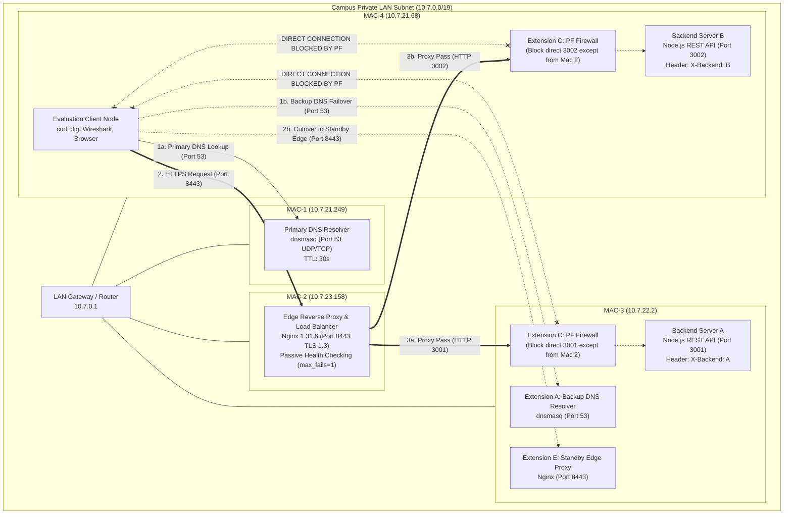
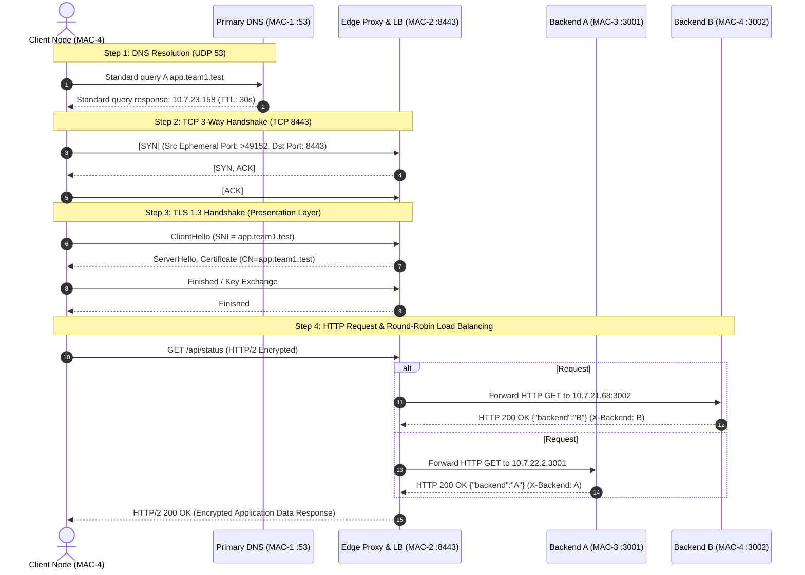
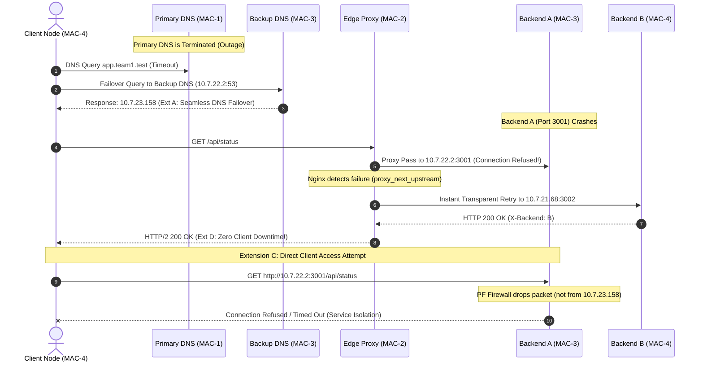

# Master Architecture Document — Computer Networks Course Project
## Private Network Service Platform (Team 1 — Phase 1 & Phase 2 Architecture)

---

## 1. System Overview & Machine Inventory Table

The system is deployed locally on a dedicated private LAN subnet (`10.7.0.0/19`), featuring full DNS resolution, TLS 1.3 termination, HTTP/2 multiplexing, active load balancing, HTTP caching, service isolation, automated failover, and fault diagnosability.

| Machine Directory | LAN IPv4 | Bound Ports | Phase 1 Role | Phase 2 Extensions | Cloud Equivalent |
|---|---|---|---|---|---|
| **[`MAC-1/`](MAC-1/)** | `10.7.21.249` | `53/UDP`, `53/TCP` | Primary Authoritative & Recursive DNS Resolver | Primary DNS Service Lifecycle Controller | AWS Route 53 / CoreDNS |
| **[`MAC-2/`](MAC-2/)** | `10.7.23.158` | `8443/TCP`, `80/TCP` | Edge Reverse Proxy & Upstream Load Balancer (TLS 1.3) | Nginx HA Passive Health Checking & Ejection | AWS Application Load Balancer |
| **[`MAC-3/`](MAC-3/)** | `10.7.22.2` | `3001/TCP`, `53/UDP`, `8443/TCP` | Upstream Application Backend Server A | **Ext A**: Backup DNS **Ext C**: PF Service Isolation **Ext E**: Standby Edge Gateway | AWS EC2 Node + Standby Load Balancer |
| **[`MAC-4/`](MAC-4/)** | `10.7.21.68` | `3002/TCP` | Upstream Application Backend Server B + Test Client | **Ext C**: PF Service Isolation Primary Evaluation Client Node | AWS EC2 Node + Client Workstation |

- **Subnet Range**: `10.7.0.0/19` (Netmask: `255.255.224.0`)
- **Default Gateway**: `10.7.0.1`
- **Private Domain Namespace**: `app.team1.test`, `api.team1.test`, `team1.test`
- **DNS Record TTL**: `30 seconds` (`local-ttl=30`)

---

## 2. Comprehensive Network Topology Diagram

---

## 3. End-to-End Protocol Request & Failover Flows

### 3.1 Normal Request Flow (DNS → TLS → Reverse Proxy → Upstream)

### 3.2 Phase 2 High-Availability Failover & Resilience Flow

---

## 4. OSI & TCP/IP Layer Mapping

| Layer # | OSI Layer Name | TCP/IP Layer Name | Protocol / Component in Project | Verification & Tooling |
|---|---|---|---|---|
| **7** | Application | Application | DNS (`dnsmasq`), HTTP/1.1, HTTP/2, REST APIs | `dig`, `curl -kv`, dnsmasq query logs |
| **6** | Presentation | Application / TLS | TLS 1.3 (OpenSSL, Nginx cert termination) | Certificate `CN=app.team1.test`, SNI |
| **5** | Session | Application / TLS | TLS Session Keys & Connection Management | Wireshark `ClientHello (SNI)` |
| **4** | Transport | Transport | TCP (8443, 3001, 3002), UDP (53) | Wireshark `tcp.flags.syn == 1`, `nc -zv` |
| **3** | Network | Internet | IPv4 Packets, Subnet Routing (`10.7.0.0/19`), PF Firewall | `ping -c 3`, `netstat -rn`, `pfctl -s rules` |
| **2** | Data Link | Network Access | Ethernet / Wi-Fi Frames (MAC Addresses) | `ifconfig en0`, Wireshark Ethernet frames |
| **1** | Physical | Network Access | 802.11ac/ax Wi-Fi RF Radio Signals | Local Wireless Access Point |

---

## 5. Phase 2 Resilience Architecture Reference

- **Extension A (Backup DNS)**: Client resolver table configured with Primary (`10.7.21.249`) and Backup (`10.7.22.2`). Transparent name resolution continuity upon Primary crash.
- **Extension B (DNS TTL & Cache Control)**: Authoritative TTL configured to `30s`. Client-side caching behavior and manual cache invalidation via `dscacheutil -flushcache`.
- **Extension C (Service Isolation)**: macOS Packet Filter (`pfctl`) deployed on Mac 3 and Mac 4, strictly isolating backend application ports to accept traffic exclusively from Mac 2 (`10.7.23.158`).
- **Extension D (High-Availability Failover)**: Nginx upstream cluster configured with `max_fails=1 fail_timeout=3s` and `proxy_next_upstream error timeout http_502`. Immediate automatic retry prevents dropped requests.
- **Extension E (Controlled Edge Migration)**: Standby Edge proxy configured on Mac 3; DNS authoritative record shifted to enable blue/green infrastructure cutover.
- **Extension F (Fault Troubleshooting Runbook)**: Layer-by-layer isolation script (`troubleshoot_fault.sh`) identifying DNS, TCP, TLS, or Application failures during faculty-injected fault challenges.
