# Phase 2 Final Report: Harden, Recover, and Troubleshoot

**Team 1 · Private Network Service Platform · `app.team1.test`**
Computer Networks Course Project, Review 2 · Tests run live on 23–24 November 2026 · campus Wi-Fi `10.7.0.0/19`

| Member | Machine | Phase 2 responsibility |
|---|---|---|
| Ankit | Mac 1 · 10.7.5.14 | Primary DNS (dnsmasq), DNS record changes, test client |
| Karan | Mac 2 · 10.7.31.100 | Primary edge: nginx TLS termination, load balancing, failover |
| Kushagra | Mac 3 · 10.7.13.57 | Backend A, backup DNS, standby edge, pf isolation of port 3001 |
| Anshika Seth | Mac 4 · 10.7.17.220 | Backend B, pf isolation of port 3002, main test client, diagnosis |

**Contents.** 1 Summary of results · 2 What changed from Phase 1 · 3 Resilience tests and results (Extensions A–E) · 4 Troubleshooting findings (Extension F) · 5 Learning summary, one paragraph per extension · 6 Limitations · Appendix: evidence files

Every result in this report comes from a live test on the four Macs. Each figure is a screenshot taken during that test; the matching text logs and packet captures are in `MAC-1…4/evidence/phase2/`, and the full screenshot index is in `evidence/screenshots/README.md`.

---

## 1. Summary of results

| Extension | What we had to show | What we observed | Result |
|---|---|---|---|
| **A** Backup DNS | Clients keep resolving when the primary DNS stops | Mac 1 DNS stopped → Mac 3 answered `10.7.31.100`; HTTPS request still `200` in 0.33 s | **Passed** |
| **B** TTL and record change | Old cached answer until TTL expires; flush gives an instant change | Cache stayed on the old IP 23 s (run 1) and 3 s (run 2) after the change; flush switched it immediately | **Passed** |
| **C** Service isolation | Only the edge reaches ports 3001/3002; rollback | Client: `Operation timed out`; edge: `succeeded`; after rollback client `succeeded` again | **Passed** |
| **D** HA failover | Backend A down → all traffic on B; A back → balancing resumes | 60 of 60 requests returned `200` while A was down; A/B alternation resumed after restart | **Passed** |
| **E** Edge migration | DNS cutover to a standby edge; cached clients briefly on the old edge | Served by `mac2-primary` until cache expiry, then `mac3-standby`; confirmed in both edges' access logs | **Passed** |
| **F** Troubleshooting | Find the failing layer systematically | Drills: edge stopped → verdict **L4 (TCP refused)**; backends stopped → verdict **L7 (HTTP 502)** | **Passed** |

---

## 2. What changed from Phase 1

Phase 2 extends the Phase 1 system; nothing was rebuilt from scratch.

| Area | Phase 1 | Phase 2 |
|---|---|---|
| IP management | IPs written into ~30 files; DHCP changed them between sessions | **`team.env`** holds the four IPs; scripts read it; `scripts/check_ips.sh` lists any config that disagrees |
| DNS | One dnsmasq on Mac 1 | **Backup dnsmasq on Mac 3** with identical records; clients list both (Ext A) |
| Edge | One nginx on Mac 2 | **Standby nginx on Mac 3** with the same certificate and backend pool; an `X-Edge` header shows which edge answered (Ext E) |
| Load balancer | Round-robin with per-worker state (uneven `A A A B B A`) | `zone backend_cluster 1m;` shares state between workers → strict A/B alternation and consistent failover (Ext D) |
| Backends | Reachable directly by any client | **pf firewall anchor** on Mac 3 and Mac 4: only the edges may connect (Ext C) |
| Caching | 304 only from Backend A (different ETag on B) | Identical `/cached` body and ETag on both backends; Backend B gained `HEAD` support |
| TLS trust | Mac 4 trusted the server certificate; demos used `-k` | Clients trust the **Root CA** in the System keychain; plain `curl https://app.team1.test:8443` verifies |
| Troubleshooting | Script fell back to `127.0.0.1` and `-k` | `scripts/diagnose.sh` checks L0 → DNS → TCP → TLS → HTTP across the LAN, plus a written runbook |

### Final topology

```
 client (Mac 4) ──DNS UDP 53──► Mac 1 dnsmasq (primary)   ┐ same records,
        │        └─(fallback)─► Mac 3 dnsmasq (backup)    ┘ TTL 30 s
        │ HTTPS 8443 (TLS 1.3, HTTP/2)
        ▼
 Mac 2 nginx (primary edge)        Mac 3 nginx (standby edge, same certificate)
        │ round-robin · shared zone · passive health check · retry
        ├──HTTP──► Mac 3 :3001 Backend A   ┐ pf: only 10.7.31.100 (edge) and
        └──HTTP──► Mac 4 :3002 Backend B   ┘ 10.7.13.57 (standby edge) may connect
```

The system was checked end to end on the new IP addresses before any Phase 2 test. The first figure shows one request from Mac 4 captured on the wire: the DNS query to Mac 1 on UDP 53, the TCP handshake to port 8443 from an ephemeral client port, and the TLS handshake followed by encrypted data.

<figure>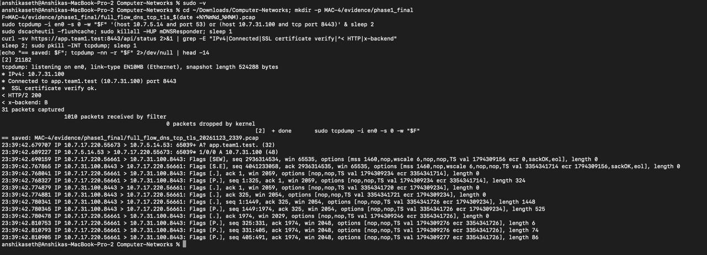<figcaption>Figure 1. Mac 4 packet capture of one HTTPS request: DNS query and answer (10.7.31.100), TCP SYN / SYN-ACK / ACK to port 8443, then the TLS handshake and encrypted application data.</figcaption></figure>

---

## 3. Resilience tests and results

### 3.1 Extension A: Backup DNS resolver

**Objective.** Keep name resolution working when the primary DNS server fails.

**Setup.** `MAC-3/configs/dnsmasq_backup.conf` is an exact copy of Mac 1's records (`app/api/team1.test → 10.7.31.100`, `local-ttl=30`). It does not forward queries to Mac 1, so it can answer on its own. Every client lists both servers: Mac 1 uses `127.0.0.1, 10.7.13.57`, Mac 2 uses `10.7.5.14, 10.7.13.57`, and Mac 4 uses `/etc/resolver/team1.test` with the same two servers (see §6).

<figure>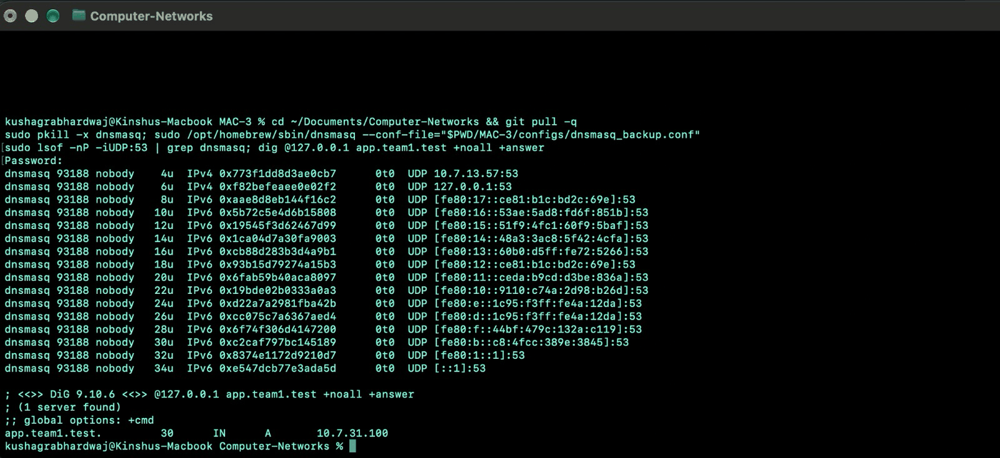<figcaption>Figure 2. Backup dnsmasq running on Mac 3 (UDP 53 on 10.7.13.57) and answering app.team1.test → 10.7.31.100 with TTL 30.</figcaption></figure>

**Test and results** (log `MAC-4/evidence/phase2/extA_backup_dns_20261123_2352.log` and `.pcap`):

| Time | Observation |
|---|---|
| 23:52:35 | Both servers answer: primary `10.7.5.14 → 10.7.31.100`, backup `10.7.13.57 → 10.7.31.100` |
| — | dnsmasq stopped on Mac 1 |
| 23:53:53 | Primary **timed out**; backup → `10.7.31.100`; system resolver → `10.7.31.100`; **HTTPS `code=200` in 0.33 s** |
| pcap | Mac 1 replies `ICMP udp port 53 unreachable`; the resolver then asks `10.7.13.57` and gets the answer |

<figure>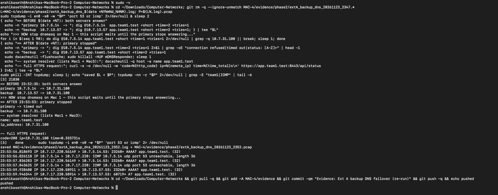<figcaption>Figure 3. Primary DNS stopped: the primary times out, the backup answers, the HTTPS request still succeeds, and the capture shows ICMP "port 53 unreachable" from Mac 1 followed by queries to Mac 3.</figcaption></figure>

### 3.2 Extension B: DNS TTL and controlled record change

**Objective.** Show that clients keep a cached answer until the TTL expires, and that a manual flush applies a change at once.

**Setup.** `local-ttl=30` on both DNS servers. The record for `app.team1.test` was changed on **both** servers (Mac 1 with `MAC-1/scripts/phase2_ttl_cutover_demo.sh`, Mac 3 with the same edit), and dnsmasq was **restarted**, because SIGHUP does not reload `address=` lines. A script on Mac 4 printed, every 3 seconds, the answer from the DNS server, the answer in the client cache (`dscacheutil`), and which edge served the request.

**Run 1** (log `extBE_ttl_cutover_20261124_0024_run1_TTL_ok_standby_not_ready.log`):

| Time | DNS server (Mac 1) | Mac 4 cache |
|---|---|---|
| 00:25:47 | 10.7.31.100 | 10.7.31.100 |
| **00:25:50** | **10.7.13.57** (changed) | 10.7.31.100 (still old) |
| 00:26:09 | 10.7.13.57 | 10.7.31.100 (still old) |
| **00:26:13** | 10.7.13.57 | **10.7.13.57** (cache expired after ~23 s) |

<figure>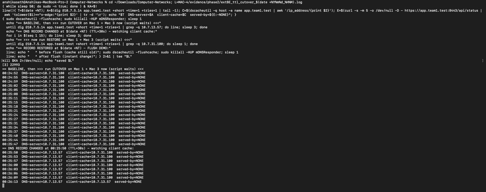<figcaption>Figure 4. Run 1: the DNS server already returns the new address (10.7.13.57) at 00:25:50, but the client cache keeps the old address until 00:26:13.</figcaption></figure>

**Run 2** (log `extBE_ttl_cutover_20261124_0030_run2_FINAL.log`, shown in the cutover figure in §3.5): the change at 00:32:00 reached the cache at 00:32:03 (~3 s, because the cached entry was already close to expiry). After the record was restored at 00:32:52 the cache was still stale (`10.7.13.57`); `sudo dscacheutil -flushcache; sudo killall -HUP mDNSResponder` switched it to `10.7.31.100` at 00:32:54.

### 3.3 Extension C: Service isolation (backend firewall)

**Objective.** Allow only the edge to reach backend ports 3001 and 3002, and be able to roll the change back.

**Setup.** `sudo ./scripts/pf_isolation.sh enable 3001` on Mac 3 and `enable 3002` on Mac 4. The rules are loaded only into the sub-anchor `com.apple/cn-isolation`, which the standard macOS ruleset already evaluates, so **`/etc/pf.conf` is never modified**. The original pf state is saved before enabling, and pf is enabled with a reference token so that rollback restores it exactly.

```
pass  in quick on lo0 proto tcp from any to any port 3001
pass  in quick proto tcp from { 10.7.31.100, 10.7.13.57 } to any port 3001   # primary + standby edge
block drop in quick proto tcp from any to any port 3001
```

<figure>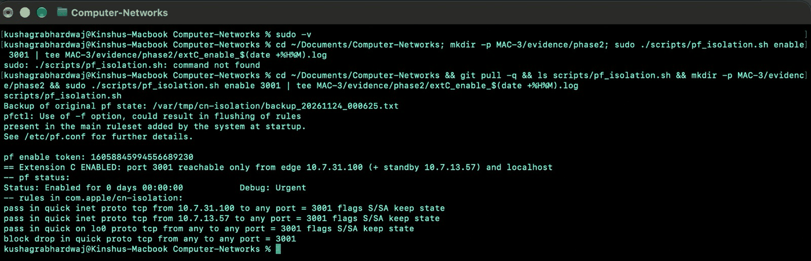<figcaption>Figure 5. Isolation enabled on Mac 3: original state backed up, pf enabled, and the three rules loaded in the com.apple/cn-isolation anchor.</figcaption></figure>

**Test and results** (logs `MAC-1/evidence/phase2/extC_client_view_20261123_2359.log`, `MAC-2/evidence/phase2/extC_edge_view_0009.log`, `MAC-4/evidence/phase2/extC_e2e_0009.log`, `MAC-3/evidence/phase2/extC_enable_0006.log`):

| Time | Tested from | Result |
|---|---|---|
| 00:01:33 | Mac 1 (client), before | 3001 and 3002 `succeeded` – anyone could bypass the edge |
| 00:06 | Mac 3, Mac 4 | Rules enabled, pf `Status: Enabled` |
| 00:08:59 | Mac 1 (client) | 3001 and 3002 **`Operation timed out`** |
| 00:09:08 | Mac 2 (edge) | 3001 and 3002 `succeeded`; Backend A returned JSON |
| 00:09:14 | Mac 4 (client) | Direct to 3001 **timed out**; through the edge `HTTP/2 200`, B, A, B, A |
| Rollback | Mac 3, Mac 4 | `ROLLED BACK`, anchor empty, pf back to its original `Disabled` state |
| 00:12:19 | Mac 1 (client) | 3001 and 3002 `succeeded` again – rollback confirmed |

<figure>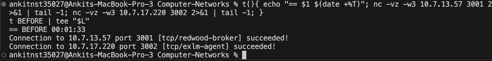<figcaption>Figure 6. Before isolation: a client (Mac 1) connects directly to both backend ports.</figcaption></figure>

<figure>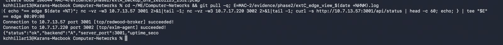<figcaption>Figure 7. With isolation on: the edge (Mac 2) still reaches both backends, while clients time out (Mac 1 log at 00:08:59, Mac 4 log at 00:09:14).</figcaption></figure>

<figure>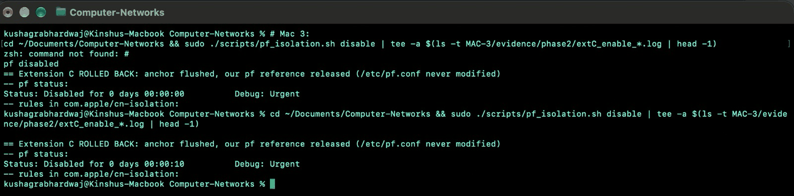<figcaption>Figure 8. Rollback on Mac 3: the anchor is flushed and pf returns to its original disabled state.</figcaption></figure>

<figure>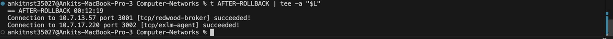<figcaption>Figure 9. After rollback the client reaches both backends again.</figcaption></figure>

### 3.4 Extension D: High-availability failover

**Objective.** When a backend fails, route all traffic to the healthy one without client errors, and resume balancing when it returns.

**Setup** (`MAC-2/configs/nginx.conf`):
```
upstream backend_cluster {
    zone backend_cluster 1m;                           # shared state for all workers
    server 10.7.13.57:3001  max_fails=2 fail_timeout=5s;
    server 10.7.17.220:3002 max_fails=2 fail_timeout=5s;
}
proxy_next_upstream error timeout http_502 http_503 http_504;   # retry on the other backend
proxy_connect_timeout 2s;
```

**Test and results** (logs `MAC-4/evidence/phase2/extD_ha_failover_20261123_2341.log`, `extD_recovery_20261123_2344.log`, `MAC-2/evidence/phase2/extD_nginx_*.log`). Mac 4 sent one request per second for 60 seconds while Backend A was stopped and restarted.

| Time | Observation |
|---|---|
| Until 23:41:56 | Strict B, A, B, A, all `200` |
| 23:41:55 | Backend A stopped on Mac 3 |
| 23:41:58, 23:42:02 | nginx tried A, got `connect() failed (61: Connection refused)`, and **retried on B inside the same request** (`upstream: 10.7.13.57:3001, 10.7.17.220:3002`). These requests took ~1.2–1.4 s instead of ~0.1 s |
| 23:42:03–08 | Only B; error log `upstream server temporarily disabled` (two failures → A skipped for 5 s) |
| Whole run | **60 of 60 client requests returned `200`** |
| 23:44:15 onward | A restarted → B, A, B, A again |

<figure>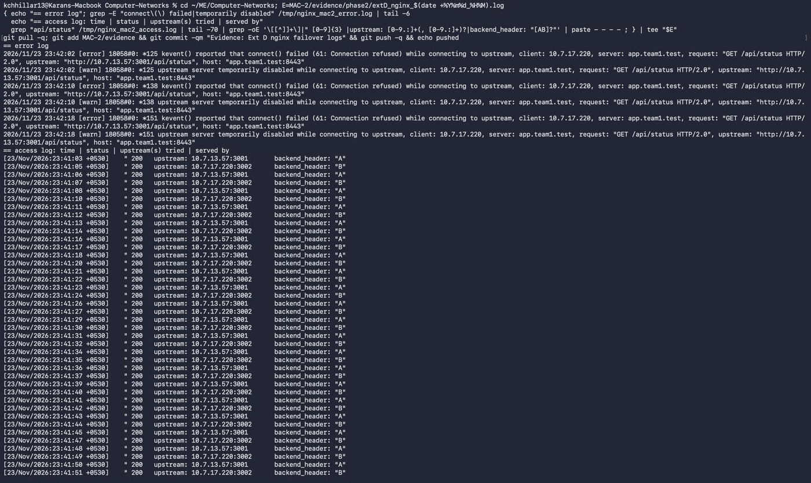<figcaption>Figure 10. Mac 2 nginx error log: connection to Backend A refused, then "upstream server temporarily disabled".</figcaption></figure>

<figure>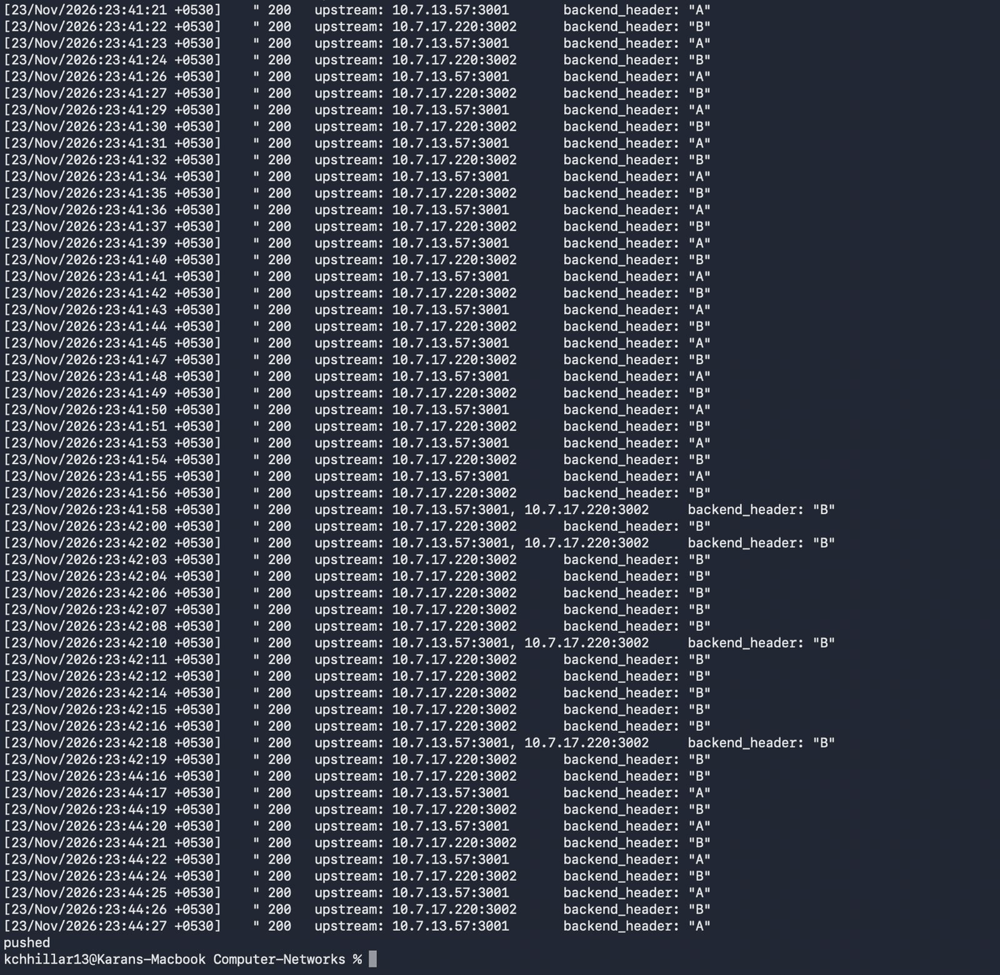<figcaption>Figure 11. Mac 2 access log: alternating A/B, then requests that tried A and were served by B, then B only while A was down.</figcaption></figure>

### 3.5 Extension E: Controlled edge migration (DNS-based cutover)

**Objective.** Move client traffic from the primary edge to a standby edge using only a DNS change, and show the effect of TTL on clients that already have a cached answer.

**Setup.** `MAC-3/configs/nginx.conf` is the Mac 2 configuration with three differences only: log and pid file names, the header `X-Edge: mac3-standby`, and the certificate path, which points to **Mac 2's certificate and key**. Because both edges present the same certificate (CN `app.team1.test`, signed by our Root CA), clients see no TLS warning after the cutover. Both edges use the same backend pool.

**Test and results** (log `extBE_ttl_cutover_20261124_0030_run2_FINAL.log`):

| Time | DNS server | Mac 4 cache | Served by |
|---|---|---|---|
| 00:30:44–00:31:56 | 10.7.31.100 | 10.7.31.100 | **mac2-primary** |
| 00:31:59 / 00:32:04 | Record changed on Mac 1 / Mac 3 | | |
| 00:32:00 | 10.7.13.57 | 10.7.31.100 | mac2-primary (client still on its cached answer) |
| **00:32:03–00:32:47** | 10.7.13.57 | 10.7.13.57 | **mac3-standby** (HTTP 200, certificate verified) |
| 00:32:51 | Record restored | | |
| 00:32:52 | 10.7.31.100 | 10.7.13.57 | mac3-standby (stale cache) |
| 00:32:54 | After manual flush | 10.7.31.100 | **mac2-primary** |

<figure>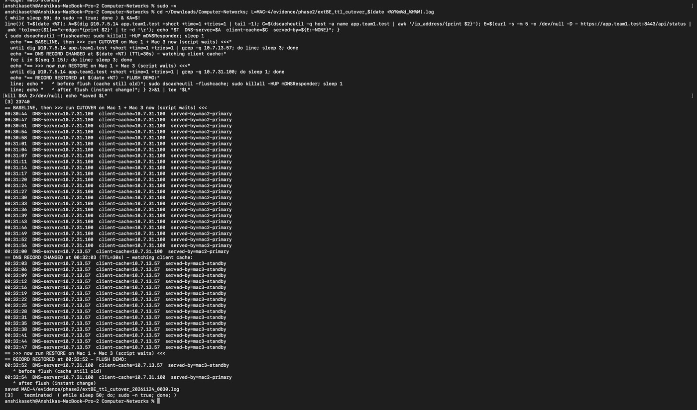<figcaption>Figure 12. Mac 4 during the cutover: served by mac2-primary, then by mac3-standby once the cache took the new record; after the restore, the flush moved it back to mac2-primary instantly.</figcaption></figure>

The two edges' access logs show the same move from the server side: Mac 2 logged Mac 4's last request at **00:32:00**, and Mac 3's standby logged Mac 4 from **00:32:03** to **00:32:52**. No request was lost in between.

<figure>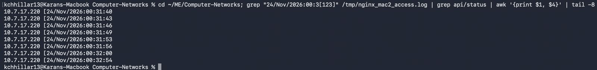<figcaption>Figure 13. Primary edge (Mac 2): requests from Mac 4 stop at 00:32:00 and return at 00:32:54.</figcaption></figure>

<figure>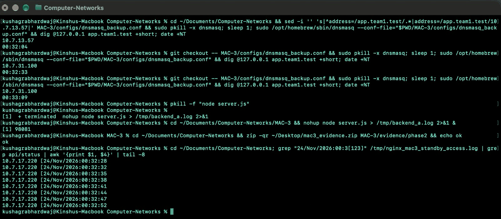<figcaption>Figure 14. Standby edge (Mac 3): requests from Mac 4 during the cutover window, up to 00:32:52.</figcaption></figure>

**Problem found in run 1.** In the first attempt the standby nginx on Mac 3 had not started (its configuration still pointed to an old certificate path). After the DNS change, clients whose cache expired were sent to an edge that was not running, and requests failed (`served-by=NONE`). The fix was to rebuild the standby configuration from Mac 2's. The lesson: **test the new target directly before changing DNS** (`curl --resolve app.team1.test:8443:<new-ip> …`).

### 3.6 Phase 1 failure scenarios, repeated on the LAN

The five failure scenarios from Section 6.3 were repeated on the real LAN on 24 November (00:52), so that every one is backed by a live result.

| Scenario | Observation | What it shows |
|---|---|---|
| Wrong DNS server | `dig @10.7.17.220` → `connection timed out`, but `ping 10.7.31.100` succeeds | DNS and IP connectivity are separate layers |
| DNS points to a wrong IP | `Trying 10.7.5.14:8443` → `Connection refused` | DNS is only a directory; it does not check the destination |
| One backend stopped | All requests served by B (§3.4) | Edge failover |
| Both backends stopped | `HTTP 502 Bad Gateway`, DNS/TCP/TLS still pass (§4.2) | Where the edge ends and the backend begins |
| Wrong port | `Trying 10.7.31.100:9999` → `Connection refused` | The host is reachable; the port is a separate identifier |

<figure>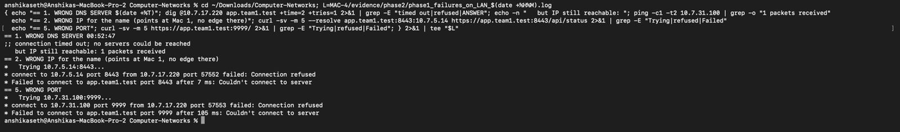<figcaption>Figure 15. Wrong DNS server, wrong IP and wrong port, run from Mac 4 on the LAN.</figcaption></figure>

---

## 4. Troubleshooting findings (Extension F)

### 4.1 Method

We test one layer at a time from the client, top-down, and stop at the first layer that fails:

| Layer | Check | Healthy result |
|---|---|---|
| L0 Link / IP | own IP, ping to all four Macs | replies |
| L1 DNS | `dig @10.7.5.14`, `dig @10.7.13.57`, system resolver, `/etc/hosts` | `10.7.31.100` everywhere |
| L4 TCP | `nc -vz 10.7.31.100 8443` | `succeeded` |
| L5/6 TLS | `openssl s_client … -CAfile ca.crt`, curl with the system trust store | `Verify return code: 0 (ok)` |
| L7 HTTP | `curl https://app.team1.test:8443/api/status` | `200`, `X-Edge`, `X-Backend` |

`scripts/diagnose.sh` runs these checks in order and prints the first failing layer. `docs/EXT_F_TROUBLESHOOTING_RUNBOOK.md` maps each symptom to its likely cause and fix. Two error words narrow the problem quickly: **refused** means the host is up but nothing is listening on the port; **timed out** means packets are dropped (firewall) or the host is unreachable.

<figure>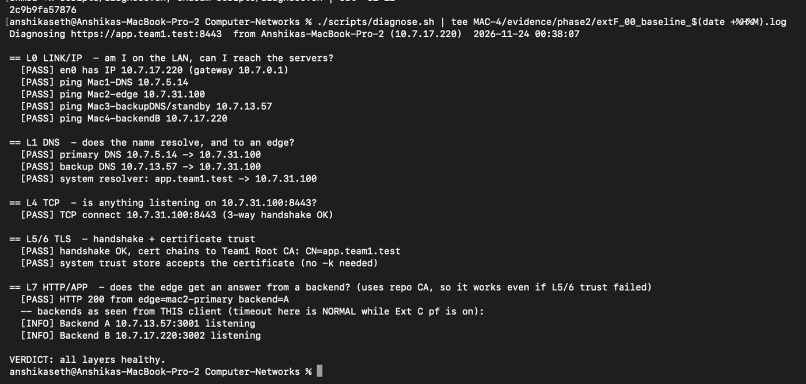<figcaption>Figure 16. Baseline run of diagnose.sh on Mac 4: every layer passes.</figcaption></figure>

### 4.2 Practice drills

One team member injected a fault; another diagnosed it using only the script and the runbook (logs `MAC-4/evidence/phase2/extF_*.log`).

| Drill | Injected fault | What diagnose.sh showed | Verdict | Fix |
|---|---|---|---|---|
| Baseline 00:38:07 | none | all checks pass, `HTTP 200 edge=mac2-primary` | healthy | — |
| D2 00:39:29 | nginx stopped on Mac 2 | ping and DNS pass, `TCP 10.7.31.100:8443 REFUSED` | **L4** | start nginx |
| D3 00:41:16 | both backends stopped | DNS, TCP, TLS pass, `HTTP 502 Bad Gateway`, backends refused | **L7** | restart backends → healthy |

<figure>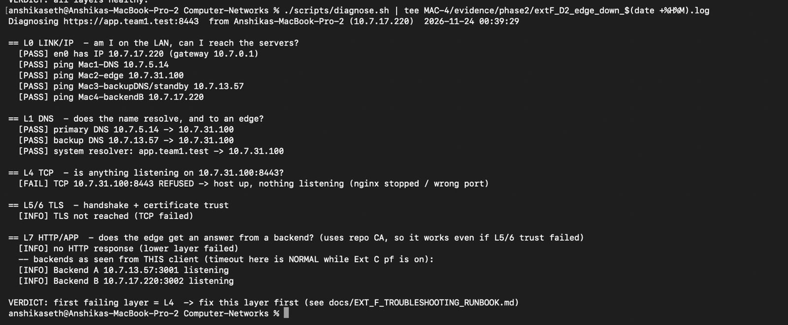<figcaption>Figure 17. Drill D2 (edge stopped): DNS is fine, TCP to 8443 is refused, verdict L4.</figcaption></figure>

<figure>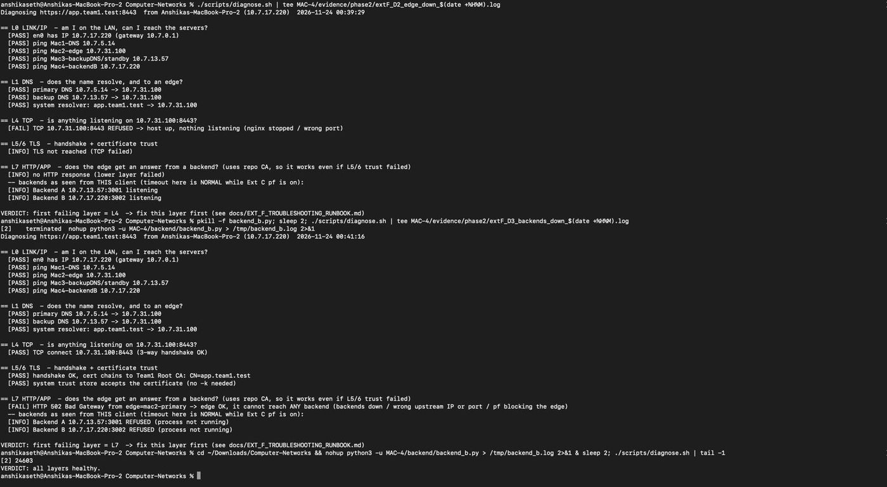<figcaption>Figure 18. Drill D3 (both backends stopped): DNS, TCP and TLS pass, HTTP 502, verdict L7; after restarting the backends, all layers are healthy again.</figcaption></figure>

### 4.3 Real faults found during the project

These problems came up while building and testing Phase 2. Each was found with the same layer-by-layer method.

| Symptom | Layer | Cause | Fix |
|---|---|---|---|
| Mac 4 `dig` used `8.8.8.8` after setting DNS manually | L1 DNS | Cloudflare WARP was running, and DHCP DNS overrode the manual setting | Quit WARP; per-domain resolver `/etc/resolver/team1.test` |
| `curl: (60) unable to get local issuer certificate` | L5/6 TLS | Mac 4 trusted the server certificate, not the Root CA | Removed it; trusted `Team1 Local Root CA` |
| `curl -I` → `HTTP 501` from Backend B | L7 | The Python server had no `HEAD` handler | Added `HEAD` support |
| nginx warned `duplicate header line: Server` | L7 | Backend B sent `Server` twice | Sent it once |
| Uneven round-robin (`B B A A A B`) | L7 | Each nginx worker kept its own counter | `zone backend_cluster 1m;` |
| DNS cutover sent clients to a dead edge | L4/L5 | Standby nginx not started (old certificate path) | Rebuilt the standby config; test the target before cutover |
| `Could not resolve host: github.com` when pushing | L1 DNS | Old manual DNS servers on the coordinating Mac | Reset DNS to automatic |
| Team IPs changed between sessions | L3 | DHCP leases plus rotating private Wi-Fi addresses | `team.env` and `check_ips.sh`; fixed Wi-Fi address |

<figure>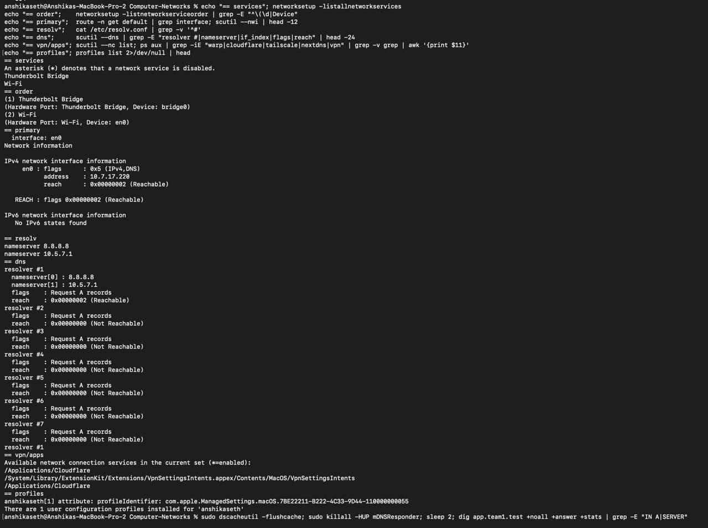<figcaption>Figure 19. Diagnosing Mac 4's DNS: the active resolver came from DHCP and a Cloudflare WARP process was running, which explained why the team DNS was ignored.</figcaption></figure>

---

## 5. Learning summary (one paragraph per extension)

**Extension A: Backup DNS resolver.** A DNS service failure stops the client before any connection starts: the name does not resolve (`curl: (6) Could not resolve host`). An application server failure leaves DNS working, and the client gets a refused connection or an HTTP 502 from the edge. The two need different redundancy: a second name server with the same records for DNS, and a load balancer with health checks for the application. The capture showed that Mac 1 was still alive (it answered with ICMP "port unreachable") but nothing was listening on port 53, so the resolver moved on to Mac 3.

**Extension B: DNS TTL and controlled record change.** The TTL is how long a client may reuse an answer. The delay a client sees after a change is the remaining TTL of its cached entry, so it can be anywhere from 0 to 30 seconds; we measured 23 s and 3 s. Before a planned migration, operators lower the TTL in advance so the change spreads quickly. A short TTL gives fast cutover but more DNS queries; a long TTL gives less load but slower recovery. `dig` asks the server directly and skips the macOS cache, so cache behaviour has to be checked with `dscacheutil` or a real request.

**Extension C: Service isolation.** With the backends reachable only from the edge, clients cannot bypass TLS, logging or load balancing; this is the principle of least privilege applied to the network. A dropped packet shows up as a timeout, while a closed port answers with a refusal, so the two errors tell a firewall problem apart from a stopped service. Keeping the rules in their own anchor made the change easy to apply and to undo without touching the system's firewall configuration.

**Extension D: High-availability failover.** Open-source nginx uses passive health checks: it learns that a backend is down when real requests fail, retries those requests on the other backend, and avoids the failed one for `fail_timeout`. The cost is a slower response for the first requests after a failure (about 1.3 s instead of 0.1 s). The nginx edge on Mac 2 is now the single point of failure: if it stops, every request fails, as drill D2 showed. Removing it needs a second edge (which we built in Extension E) plus a way to move traffic automatically, such as a floating IP with VRRP/keepalived, DNS failover driven by health checks, or a managed cloud load balancer.

**Extension E: Controlled edge migration.** A DNS cutover moves new lookups, not existing clients: each client moves when its cached answer expires, so the old edge must keep running for at least one TTL. Both DNS servers must be changed together, or clients get different answers depending on which server they ask. The standby must present a certificate the clients already trust, otherwise the migration appears to users as a TLS error. Our failed first run showed that the new target must be tested before DNS is changed.

**Extension F: Troubleshooting.** Faults rarely appear where they first seem to be. A "DNS problem" on Mac 4 was really a VPN client overriding the resolver, and a "TLS problem" was the wrong certificate in the trust store. Checking one layer at a time from the client and stopping at the first failure found each cause quickly, and the drills confirmed the pattern: a stopped edge shows up as a refused TCP connection (L4), while stopped backends show up as HTTP 502 with DNS, TCP and TLS still healthy (L7).

**Overall.** Each layer needs its own redundancy and its own check. A backup DNS server does nothing for a dead backend, and backend health checks do nothing for a failed edge. DNS-based migration works within the limits of TTL and caching, so it has to be planned. Testing layer by layer was faster and more reliable than guessing.

---

## 6. Limitations

- **Mac 4 DNS.** Campus DHCP kept overriding the manual Wi-Fi DNS on Mac 4, so it resolves `team1.test` through `/etc/resolver/team1.test`, which lists both team DNS servers. Plain `dig` does not use that file; on Mac 4 we show resolution with `dscacheutil -q host -a name app.team1.test` or `dig @10.7.5.14`.
- **The edge is still a single point of failure.** Extension E moves traffic manually through DNS; there is no automatic edge failover.
- **IP addresses are DHCP leases.** If they change, `team.env` is updated and `scripts/check_ips.sh` lists the configuration lines to fix.
- **Private keys are in the repository** because this is a closed lab; a real deployment would keep them in a secret store.

---

## Appendix: evidence files

| Extension | Logs and captures | Screenshots (`evidence/screenshots/`) |
|---|---|---|
| Baseline / Task G | `MAC-4/evidence/phase1_final/full_flow_dns_tcp_tls_*.pcap` | `P1_TaskG_*`, `S0_*`, `S1_*` |
| A | `MAC-4/evidence/phase2/extA_backup_dns_20261123_2352.log`, `.pcap` | `ExtA_01` – `ExtA_06` |
| B | `MAC-4/evidence/phase2/extBE_ttl_cutover_20261124_0024_run1_*.log`, `…_0030_run2_FINAL.log` | `ExtB_01`, `ExtBE_05` |
| C | `MAC-1/…/extC_client_view_*.log`, `MAC-2/…/extC_edge_view_*.log`, `MAC-3/…` and `MAC-4/…/extC_enable_0006.log`, `MAC-4/…/extC_e2e_*.log` | `ExtC_00` – `ExtC_07` |
| D | `MAC-4/evidence/phase2/extD_ha_failover_*.log`, `extD_recovery_*.log`, `MAC-2/evidence/phase2/extD_nginx_*.log` | `ExtD_01` – `ExtD_04` |
| E | `MAC-4/evidence/phase2/extBE_ttl_cutover_20261124_0030_run2_FINAL.log` | `ExtE_01` – `ExtE_06`, `ExtBE_05` |
| F | `MAC-4/evidence/phase2/extF_*.log` | `ExtF_00`, `ExtF_D2_*`, `ExtF_D3_*`, `ExtF_lesson_01` |
| Section 6.3 | `MAC-4/evidence/phase2/phase1_failures_on_LAN_*.log` (on Mac 4) | `P1_6.3_*` |
